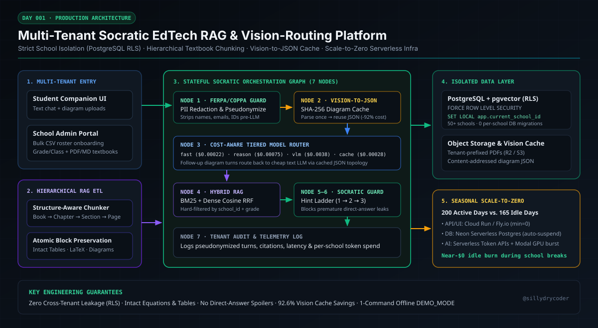
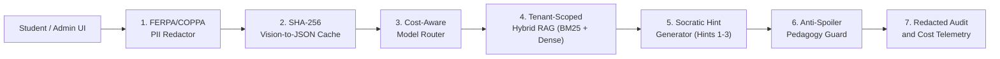

# Day 001: Multi-Tenant Socratic EdTech RAG & Vision-Routing Tutor

> **Service Pillar:** AI Agents, LangGraph & RAG Pipelines  
> **Stack:** Python · LangGraph-Style State Machine · Hybrid RAG (BM25 + Dense RRF) · Vision LLM Routing · SQLite / PostgreSQL RLS  
> **Demo Tier:** Tier 2 — Cloud-Deployable App (`Dockerfile` included) + 1-Command Offline Local Console (`./run.sh`)



---

## Business Problem

K-12 EdTech platforms deploying AI tutoring across dozens of schools face four hard architectural constraints simultaneously:

1. **Strict Multi-Tenant Data Isolation (FERPA / COPPA):** Scaling from 2,000 MVP students to 100,000+ students across 50+ schools without managing 50 separate database instances—while guaranteeing School A can *never* retrieve School B's textbooks, diagrams, or student histories.
2. **Complex Educational Content Parsing:** Textbooks mix prose, Markdown/HTML tables, LaTeX math equations, and scientific diagrams. Naive fixed-character chunking slices formulas and tables in half, destroying retrieval accuracy.
3. **Pedagogy & Vision Cost Explosion:** Generic chatbots dump direct answers instead of teaching Socratically, and sending high-resolution diagram images to Vision LLMs on every chat turn explodes token spend.
4. **Seasonal Traffic Cliffs (200 Active Days vs. 165 Idle Vacation Days):** Provisioning dedicated 24/7 GPU clusters burns thousands of dollars per month while schools are closed over summer, winter, and spring breaks.

---

## Architecture & Engineering Solution

This reference implementation demonstrates a **production-ready multi-tenant Socratic RAG & Vision-Routing engine** that runs locally in one command (`DEMO_MODE=true`, zero API keys required) and ships with the exact PostgreSQL Row-Level Security DDL and live OpenAI/Gemini provider wiring needed for production rollout.



### 1. Multi-Tenancy Without DevOps Sprawl (`schema/postgres_rls.sql` + `src/storage.py`)
- **Shared Schema + Database-Enforced Row-Level Security (RLS):** Every tenant table (`users`, `textbooks`, `knowledge_chunks`, `vision_extractions`, `tutoring_turns`) carries a mandatory `school_id` foreign key protected by PostgreSQL `ENABLE ROW LEVEL SECURITY` + `FORCE ROW LEVEL SECURITY` (`current_setting('app.current_school_id', true)::uuid`).
- **Zero Per-School Migrations:** Onboarding School #50 is a single row insert + bulk CSV roster upload (`POST /api/onboarding/csv`), not spinning up a new database cluster.
- **Runtime Enforcement:** Even in local SQLite `DEMO_MODE`, every data access method requires an explicit `TenantContext(school_id=...)` object, preventing cross-tenant queries at both the storage and retriever layers.

### 2. Structure-Aware Hierarchical Textbook Ingestion (`src/chunker.py` + `src/retriever.py`)
- **Atomic Block Parsing:** Textbooks are parsed into a `Book -> Chapter -> Section -> Page` hierarchy where **Markdown tables**, **LaTeX equations (`$$...$$`)**, and **diagram blocks** stay 100% atomic—never split mid-formula or mid-row.
- **Parent Context Breadcrumbs:** Every chunk stores its full hierarchical path (`Textbook (Subject, Grade) > Chapter > Section [p.N | block_type]`) so citations remain precise.
- **Hybrid Retrieval (RRF):** Combines **BM25 lexical scoring** (critical for exact math symbols, `Fig 2.4`, `sin(30)`, `ATP`) with **dense cosine similarity** fused via **Reciprocal Rank Fusion (RRF)**, hard-filtered by `school_id`.
- *Production PDF Extraction Note:* In production, swap the Markdown ingestion hook with layout-aware PDF parsing (`Docling` / `Marker` / `LlamaParse`) outputting the exact same atomic Markdown + LaTeX + cropped figure structure.

### 3. Cost-Aware Model Routing & Vision-to-JSON Deduplication (`src/router.py` + `src/socratic_graph.py`)
- **Tiered Routing:**
  - Routine conceptual text turns → **Fast Serverless Text LLM** (`~$0.00022/turn`, e.g., Gemini 2.5 Flash-Lite / Llama-3.1-8B)
  - Multi-step quantitative STEM derivations → **Reasoning Text LLM** (`~$0.00075/turn`, e.g., GPT-4o-mini / DeepSeek-R1-Distill)
  - New diagram/graph/chart uploads → **Vision VLM** (`~$0.00380/turn`, e.g., Gemini 2.5 Flash Vision / Qwen2.5-VL)
- **Vision-to-JSON Cache (92.6% Follow-Up Cost Reduction):** When a student uploads a diagram, the VLM extracts its structured topology (axes, segments, forces, curves) **once** and caches it by `(school_id, image_sha256)`. Every follow-up tutoring turn on that diagram—and every other student in the same class uploading the same textbook figure—hits the cache and routes straight to the cheap fast text model!

### 4. Seasonal Scale-to-Zero Hosting Strategy (200 Active vs. 165 Idle Days)
- **Compute:** Containerized stateless API/UI on **Google Cloud Run** or **Fly.io Machines** (`min_instances = 0`) — auto-scales for 8 AM–4 PM school spikes and sleeps to `$0` overnight and during summer/winter breaks.
- **Database & Vector Index:** **Neon Serverless PostgreSQL + `pgvector`** (auto-suspend on inactivity; only pennies/GB for cold storage during breaks).
- **AI Inference:** **Pay-per-token Serverless Inference APIs** (Gemini / OpenAI / OpenRouter) or **scale-to-zero serverless GPUs** (Modal / RunPod Serverless) for open-weights `Qwen2.5-VL` — zero 24/7 idle GPU leases.
- Explore exact cost numbers interactively in Tab 4 (**Seasonal Scale-to-Zero Simulator**) of the web console.

---

## Quick Start (1-Command Local Demo)

```bash
# Start the interactive dark-mode web console at http://127.0.0.1:8000 (DEMO_MODE=true, zero API keys)
./run.sh

# Or run the non-interactive architecture smoke test (JSON telemetry output)
./run.sh --smoke-test

# Run the full automated verification suite (multi-tenant isolation, vision cache, PII redaction, HTTP API)
python3 -m unittest discover -s tests -v
```

### Switching to Live OpenAI / Gemini Mode
```bash
cp .env.example .env
# Edit .env -> set DEMO_MODE=false and add OPENAI_API_KEY or GEMINI_API_KEY
./run.sh
```

### Free Cloud Deployment (Docker / Hugging Face Spaces / Render / Cloud Run)
This repository ships with a zero-dependency [Dockerfile](Dockerfile) exposing port `7860` (`DEMO_MODE=true`) for 1-click deployment to Hugging Face Spaces, Render, or Google Cloud Run.

---

## Interactive Console Walkthrough

Once `./run.sh` is running, open `http://127.0.0.1:8000`:
1. **Tab 1 — Socratic Chat & Vision Lab:** Click **Diagram + Vision Cache** twice to watch Turn 1 invoke `vision-vlm` (`$0.00380`) and Turn 2 hit the tenant Vision Cache (`vision-cache+text-fast`, `$0.00028` — **92.6% saved!**). Click **FERPA PII Redaction** and **Cross-Tenant Isolation Check** to inspect the live 7-node execution trace.
2. **Tab 2 — Multi-Tenant & CSV Onboarding:** Switch schools in the top-right RLS selector, import bulk CSV rosters, create a brand-new isolated school tenant, and inspect `schema/postgres_rls.sql`.
3. **Tab 3 — Hierarchical Textbook RAG:** Inspect intact atomic `PROSE`, `TABLE`, `EQUATION`, and `DIAGRAM` chunks and ingest a new chapter live into only the active school.
4. **Tab 4 — Seasonal Scale-to-Zero Simulator:** Adjust sliders from 2,000 → 100,000 students across 50 schools to compare 24/7 dedicated GPUs vs. scale-to-zero serverless economics.

---

## Project Structure

```text
.
├── README.md
├── project.json
├── Dockerfile
├── .env.example
├── run.sh
├── assets/
│   └── architecture.svg               # Dark-mode system architecture diagram
├── schema/
│   └── postgres_rls.sql               # Production PostgreSQL + pgvector RLS DDL
├── sample_data/
│   ├── schools_seed.json              # 2 isolated demo schools
│   ├── roster_oakridge.csv            # Bulk CSV roster fixture (School A)
│   ├── roster_crestview.csv           # Bulk CSV roster fixture (School B)
│   ├── textbook_physics_grade10.md    # Physics chapter (prose + LaTeX + tables + diagrams)
│   ├── textbook_biology_grade9.md     # Biology chapter for cross-tenant isolation proof
│   └── sample_diagrams.json           # Pre-built math/science diagrams for Vision Routing
├── src/
│   ├── app.py                         # CLI & HTTP entry point (--smoke-test / server)
│   ├── server.py                      # REST API & static web console server
│   ├── socratic_graph.py              # 7-node stateful Socratic & Vision orchestration graph
│   ├── storage.py                     # TenantContext-enforced SQLite store & CSV importer
│   ├── chunker.py                     # Structure-aware hierarchical textbook parser
│   ├── retriever.py                   # Tenant-scoped Hybrid Retriever (BM25 + dense RRF)
│   ├── router.py                      # Cost-aware model router & seasonal cost calculator
│   ├── privacy.py                     # FERPA/COPPA PII redaction & pseudonymization
│   └── web/                           # Dark-mode interactive SPA console
└── tests/
    └── test_platform.py               # Automated unit & HTTP integration tests
```
