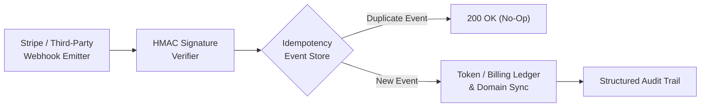

# Day {{DAY_PADDED}}: {{TITLE}}

> **Service Pillar:** {{CATEGORY_NAME}}  
> **Stack:** {{STACK_LIST}}  
> **Demo Tier:** {{DEMO_TIER}}  
> **Status:** Reference Stripe & API Middleware Architecture (Includes Offline Webhook Replay)

---

## Business Problem

{{PROBLEM}}

## Architecture & Solution

{{SOLUTION}}



## Key Capabilities

- **Idempotent Webhook Processing:** Retried or duplicate Stripe/API webhooks never double-credit or corrupt balances.
- **HMAC Signature Verification:** Production signature check wired cleanly with local `DEMO_MODE=true` signing support.
- **Offline Webhook Replay Tool:** Run `python3 src/replay_webhook.py` to test full payment/subscription/sync lifecycles without exposing localhost or spending Stripe test clicks.

---

## Quick Start (1-Command Local Run)

```bash
# Terminal 1: start the webhook & API server
./run.sh

# Terminal 2: replay realistic anonymized Stripe webhook events (including duplicate retry test)
python3 src/replay_webhook.py
```
