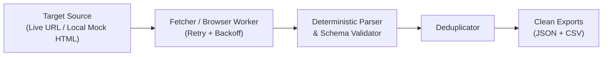

# Day {{DAY_PADDED}}: {{TITLE}}

> **Service Pillar:** {{CATEGORY_NAME}}  
> **Stack:** {{STACK_LIST}}  
> **Demo Tier:** {{DEMO_TIER}}  
> **Status:** Reference Automation & Scraping Pipeline (Offline Mock Target Included)

---

## Business Problem

{{PROBLEM}}

## Architecture & Solution

{{SOLUTION}}



## Key Capabilities

- **10-Year Offline Reproducibility:** `DEMO_MODE=true` parses `sample_data/mock_page.html`, so the scraper never rots when external websites change markup.
- **Structured Outputs:** Exports clean, deduplicated `output/results.json` and `output/results.csv`.
- **Production Swap:** Point `TARGET_URL` and switch `DEMO_MODE=false` (or wire Playwright/Puppeteer) for live targets.

---

## Quick Start (1-Command Local Run)

```bash
./run.sh
```
