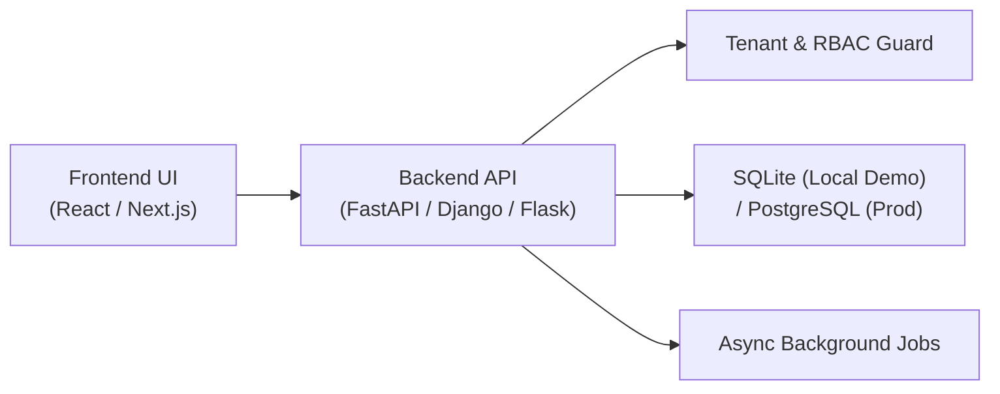

# Day {{DAY_PADDED}}: {{TITLE}}

> **Service Pillar:** {{CATEGORY_NAME}}  
> **Stack:** {{STACK_LIST}}  
> **Demo Tier:** {{DEMO_TIER}}  
> **Status:** Reference Full-Stack SaaS Architecture

---

## Business Problem

{{PROBLEM}}

## Architecture & Solution

{{SOLUTION}}



## Key Capabilities

- **Multi-Tenant Ready Structure:** Clean separation of API routes, service layer, schemas, and tenant context.
- **Zero-Friction Local Demo:** Pre-seeded SQLite / JSON demo data with one-click demo mode — no signup wall.
- **Forkable SaaS Baseline:** Swap `DATABASE_URL` to PostgreSQL and deploy backend + frontend independently.

---

## Quick Start (1-Command Local Run)

```bash
cp .env.example .env
./run.sh
```
