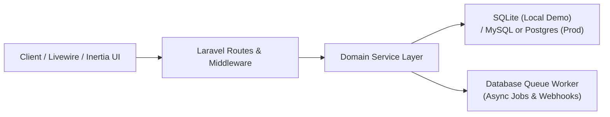

# Day {{DAY_PADDED}}: {{TITLE}}

> **Service Pillar:** {{CATEGORY_NAME}}  
> **Stack:** {{STACK_LIST}}  
> **Demo Tier:** {{DEMO_TIER}}  
> **Status:** Reference Laravel Backend Architecture (SQLite Local Demo Ready)

---

## Business Problem

{{PROBLEM}}

## Architecture & Solution

{{SOLUTION}}



## Key Capabilities

- **Clean Service-Repository Boundaries:** Thin controllers delegating to testable domain services and Form Requests.
- **SQLite Default for Zero-Setup Evaluation:** Runs locally with `php artisan migrate --seed` without needing MySQL/Docker setup first.
- **Production Swap Ready:** Change `DB_CONNECTION` and `QUEUE_CONNECTION` in `.env` for MySQL/PostgreSQL + Redis in production.

---

## Quick Start (1-Command Local Run)

```bash
cp .env.example .env
./run.sh
```
