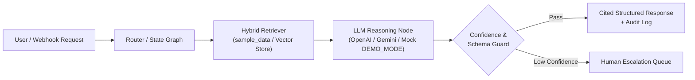

# Day {{DAY_PADDED}}: {{TITLE}}

> **Service Pillar:** {{CATEGORY_NAME}}  
> **Stack:** {{STACK_LIST}}  
> **Demo Tier:** {{DEMO_TIER}}  
> **Status:** Reference Architecture Demo (Supports Zero-Key `DEMO_MODE=true`)

---

## Business Problem

{{PROBLEM}}

## Architecture & Solution

{{SOLUTION}}



## Key Capabilities

- **Stateful Orchestration:** Clear node boundaries ready for LangGraph / LangChain production deployment.
- **Zero-Key Demo Mode (`DEMO_MODE=true`):** Runs deterministically offline against `sample_data/` with zero API credits required; drop in real keys in `.env` to enable live model calls.
- **Production Reliability:** Strict JSON schema validation, structured logging, and reproducible fixtures.

---

## Quick Start (1-Command Local Run)

```bash
cp .env.example .env   # optional — defaults to DEMO_MODE=true
./run.sh
```

### Switching to Live LLM Mode
Set `DEMO_MODE=false` and configure `OPENAI_API_KEY` (or `GEMINI_API_KEY`) inside `.env`.

---

## Project Structure

```text
.
├── README.md
├── project.json
├── .env.example
├── requirements.txt
├── run.sh
├── assets/          # Architecture diagram & UI screenshots / demo GIF
├── sample_data/     # Anonymized knowledge documents & test queries
└── src/             # Orchestration graph, retrieval logic & entry point
```
