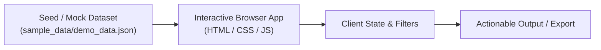

# Day {{DAY_PADDED}}: {{TITLE}}

> **Service Pillar:** {{CATEGORY_NAME}}  
> **Stack:** {{STACK_LIST}}  
> **Demo Tier:** {{DEMO_TIER}}  
> **Status:** Zero-Build Static Interactive Demo (GitHub Pages / Cloudflare / Vercel Ready)

---

## Business Problem

{{PROBLEM}}

## Architecture & Solution

{{SOLUTION}}



## Quick Start (1-Command Local Run)

```bash
./run.sh
# Opens local server at http://127.0.0.1:8080
```
